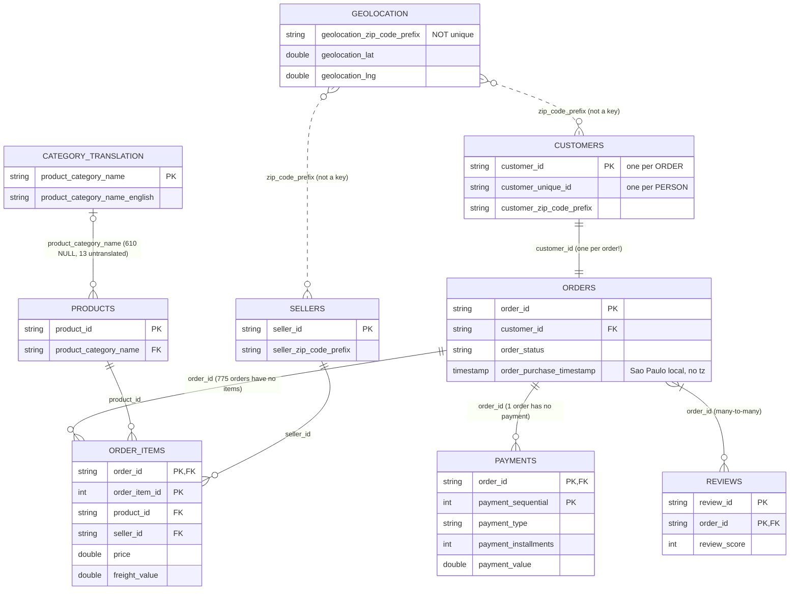

# Olist source data model

Source: Olist Brazilian E-Commerce (Kaggle), 9 CSV tables, ~1.55M rows, Sept 2016 – Oct 2018.
Every number below was verified with SQL in `sql/explore/` (`01_grain.sql`, `03_integrity.sql`).

## Entity-relationship diagram

Solid lines are real key relationships. Dotted lines are loose matches on a non-unique column.

## Grain of each table

| Table | Rows | Grain (one row = …) | Primary key |
|---|---:|---|---|
| orders | 99,441 | one order | `order_id` |
| order_items | 112,650 | one item line within an order | `(order_id, order_item_id)` |
| payments | 103,886 | one payment instalment-source within an order | `(order_id, payment_sequential)` |
| reviews | 99,224 | one review attached to one order | `(review_id, order_id)` |
| customers | 99,441 | one customer **per order** (not per person) | `customer_id` |
| products | 32,951 | one product | `product_id` |
| sellers | 3,095 | one seller | `seller_id` |
| category_translation | 71 | one Portuguese category name with its English name | `product_category_name` |
| geolocation | 1,000,163 | one lat/long point for a zip prefix (19,015 prefixes) | none (no unique key) |

## Known data-quality issues

| # | Issue | Evidence | Impact | Planned handling |
|---|---|---|---|---|
| 1 | Orders `delivered` with NULL delivery date | 8 of 96,478 delivered orders | delivery-time metrics drop or NULL these rows | DQ rule (M4): detect and report nightly |
| 2 | `customer_id` is per order, not per person | 99,441 `customer_id` vs 96,096 `customer_unique_id` | customer counts and repeat rate wrong if `customer_id` is used | use `customer_unique_id` for any person-level metric |
| 3 | Multiple payment rows per order | 103,886 rows for 99,440 orders (2,382 orders have 2 payments, some up to 29) | **fan-out**: a careless items × payments join inflates revenue from R$16.01M to R$20.31M (+27%) | aggregate each "many" table to order grain *before* joining |
| 4 | Order with no payment; odd payment values | 1 order has no payment row; 3 payments typed `not_defined`; 9 payments of 0.00 | small revenue gaps; payment-based totals ≠ item-based totals | flag in reconciliation; DQ rule (M4) |
| 5 | Orders with no items | 775 orders (603 `unavailable`, 164 `canceled`, 8 other) | inner joins to items drop them; zero item revenue | expected for these statuses; DQ rule for any other status |
| 6 | Reviews ↔ orders is many-to-many | 789 `review_id`s span 2+ orders; 547 orders have 2+ reviews | fan-out if reviews are joined to orders or items | aggregate reviews per order before joining |
| 7 | Products with missing or untranslated category | 610 NULL category + 13 products in 2 untranslated categories (`pc_gamer`, `portateis_cozinha_e_preparadores_de_alimentos`) = 623 | inner join to translation silently drops their revenue | LEFT JOIN; label NULL as `unknown`; add the 2 missing translations in our own lookup |
| 8 | Geolocation zip prefix not unique, and incomplete | 1,000,163 rows / 19,015 prefixes; 278 customers (157 prefixes) and 7 sellers have no match | ×53 fan-out on a direct join; missing location for some customers | aggregate to one row per prefix (avg lat/long) before joining; LEFT JOIN |
| 9 | Timestamps have no time zone | all 5 order timestamps are `TIMESTAMP` without tz; values are São Paulo local time | "daily" totals shift if mixed with UTC sources (FX, weather, settlements) | convert to UTC in curated layer (M4), keep local date for business reporting |
| 10 | CSV text fields contain line breaks | reviews file: 104,720 lines but 99,224 rows | line-based tools (`wc -l`, `split`) miscount or corrupt rows | always use a CSV parser; convert to Parquet in bronze (M3) |

## Rules this model imposes on the pipeline

1. **Never join two "many" tables directly.** Aggregate `order_items`, `payments` and `reviews` to `order_id` first.
2. **Dimensions are LEFT JOINed**, with `unknown` for missing values, so no revenue silently disappears.
3. **Person-level metrics use `customer_unique_id`.**
4. **Geolocation is aggregated to one row per zip prefix** before any join.
5. **Every issue above becomes an automated, counted data-quality check** in the curated layer (M4), not a one-off finding.
